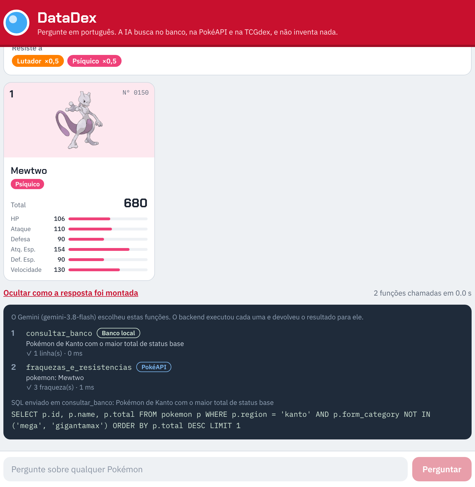

# DataDex — Pokédex com IA que não inventa respostas

Evolução do [DataChatbot](https://github.com/dheik/DataChatbot). Você pergunta sobre Pokémon em português e o
**Gemini usa function calling** para escolher de onde buscar a resposta:

- um **banco local** (SQLite) com status, tipos, regiões e habilidades de 1.323 Pokémon e formas;
- a **PokéAPI**, consultada ao vivo, para descrição da Pokédex, linha evolutiva e tabela de tipos;
- a **TCGdex**, consultada ao vivo, para as cartas do Pokémon Estampas Ilustradas (TCG).

O Gemini nunca responde de memória: ele só diz qual função quer chamar. O backend executa a função, devolve o
resultado e o Gemini escreve a resposta usando apenas esses dados. Se nenhuma função trouxer dados, a API não
mostra resposta.

> *"Quais as fraquezas do Pokémon mais forte de Kanto?"*
> 1. Gemini → `consultar_banco(sql="SELECT p.id, p.name ... WHERE p.region = 'kanto' ORDER BY p.total DESC LIMIT 1")`
> 2. Backend → banco local → `Mewtwo, total 680`
> 3. Gemini → `fraquezas_e_resistencias(pokemon="Mewtwo")`
> 4. Backend → PokéAPI `/type/psychic` → fraco contra Inseto, Fantasma e Sombrio
> 5. Gemini → resposta final em português, e o app mostra o card, as fraquezas e as funções chamadas.



## Requisitos do trabalho

| Requisito | Onde está |
|---|---|
| API do Gemini | `backend/app/llm.py` (SDK oficial `google-genai`) |
| Function calling | Declarações em `backend/app/tools.py`, laço em `backend/app/llm.py` |
| APIs externas | PokéAPI e TCGdex, chamadas ao vivo em `backend/app/external.py` |
| Interface (front-end) | App React Native (Expo) em `frontend/`, roda no navegador e no celular |
| Regras de negócio e validações | `backend/app/services.py`, `backend/app/tools.py`, `backend/app/database.py` |

## Arquitetura

```
                                            ┌──────────────────────────┐
                                     ┌────▶ │ API Gemini (function     │
┌───────────────┐  POST /api/ask  ┌──┴──────┤ calling)                 │
│ App React     │ ──────────────▶ │ Backend └──────────────────────────┘
│ Native (Expo) │ ◀────────────── │ FastAPI ┌──────────────────────────┐
└───────────────┘   JSON          │         │ Banco SQLite (local)     │
                                  │ executa ├──────────────────────────┤
                                  │ as      │ PokéAPI (ao vivo)        │
                                  │ funções ├──────────────────────────┤
                                  └────┬────┤ TCGdex (ao vivo)         │
                                       └──▶ └──────────────────────────┘
```

### As funções (function calling)

| Função | O que faz | Fonte |
|---|---|---|
| `consultar_banco(sql, explicacao)` | Rankings, filtros e contagens com um `SELECT` seguro | Banco local |
| `descricao_pokedex(pokemon)` | Descrição da Pokédex, categoria, habitat, grupos de ovo | PokéAPI `/pokemon-species` |
| `linha_evolutiva(pokemon)` | Evoluções e a condição de cada uma | PokéAPI `/evolution-chain` |
| `fraquezas_e_resistencias(pokemon \| tipos)` | Multiplicador de dano de cada tipo de ataque | PokéAPI `/type` |
| `cartas_tcg(pokemon, quantidade)` | Cartas mais recentes com imagem | TCGdex `/cards` |

Cada função é declarada com nome, descrição e parâmetros em JSON Schema (`types.FunctionDeclaration`). O laço em
`llm.py` envia as declarações em `tools`, lê `response.function_calls`, executa cada uma com o `ToolRunner` e
devolve o resultado como `FunctionResponse` (com o mesmo `id` da chamada), até o Gemini responder com texto.
A execução automática do SDK fica desligada, para o backend validar tudo.

### Regras de negócio

- Pergunta entre 3 e 300 caracteres, com texto.
- **Sem fonte, sem resposta:** se nenhuma função foi bem-sucedida, a API responde `422 not_answerable`.
  Perguntas fora do tema também (o Gemini marca com `[FORA_DO_TEMA]`).
- SQL só de leitura: uma única instrução `SELECT`, conexão somente leitura, *authorizer* do SQLite liberando apenas
  as tabelas `pokemon` e `pokemon_abilities`, tempo limite de 2 s e no máximo 50 linhas.
- Erros das funções (SQL inválido, Pokémon inexistente, API externa fora do ar) voltam para o Gemini como
  `{"erro": ...}`, e ele pode corrigir e chamar de novo.
- Até 6 rodadas de function calling por pergunta e 4 chamadas de cada função. Ao atingir o limite, o Gemini é
  obrigado a responder sem novas chamadas.
- APIs externas: tempo limite de 8 s e cache de 24 h por URL.
- Mega e Gigantamax ficam de fora das consultas, a não ser que o usuário peça.
- Respostas ficam em cache (também em disco); perguntas de continuação usam as 3 últimas perguntas da sessão.
- Limite de 20 perguntas por minuto por IP. Erros sempre no formato `{"error": {"code", "message"}}`.

## Estrutura

```
datadex/
├── backend/
│   ├── app/
│   │   ├── main.py        # rotas FastAPI, tratamento de erros, rate limit
│   │   ├── services.py    # regras de negócio (fluxo da pergunta)
│   │   ├── llm.py         # Gemini: laço de function calling e troca de modelos
│   │   ├── tools.py       # declarações das funções e o ToolRunner que as executa
│   │   ├── external.py    # PokéAPI e TCGdex (HTTP com tempo limite e cache)
│   │   ├── database.py    # banco local e execução segura do SQL
│   │   ├── prompts.py     # instrução de sistema (engenharia de prompt)
│   │   └── config.py      # configurações via .env
│   ├── data/pokemon.db    # banco pronto (1.323 Pokémon e formas)
│   ├── build_db.py        # recria o banco a partir dos CSVs da PokéAPI
│   ├── tests/             # 30 testes + respostas reais da PokéAPI em fixtures/
│   └── requirements.txt
├── frontend/              # app React Native (Expo)
│   ├── App.tsx
│   └── src/ (api.ts, theme.ts, components/)
└── docs/
    ├── DataDex_Apresentacao.pptx
    └── screenshots/
```

## Como rodar

### 1. Backend (Python 3.10+)

```bash
cd backend
python -m venv .venv
# Windows: .venv\Scripts\activate    |    macOS/Linux: source .venv/bin/activate
pip install -r requirements.txt
cp .env.example .env        # e coloque sua GEMINI_API_KEY
uvicorn app.main:app --reload --port 8000
```

A documentação interativa fica em http://localhost:8000/docs. Em http://localhost:8000/api/health dá para ver
as funções disponíveis e as APIs externas configuradas.
O banco `data/pokemon.db` já vem pronto. Para recriá-lo com os dados mais recentes da PokéAPI: `python build_db.py --refresh`.

Testes (não usam internet nem gastam cota do Gemini): `python -m pytest -q`

### 2. Frontend (Node 18+)

```bash
cd frontend
npm install
npx expo start --web        # abre no navegador
# ou: npx expo start  e escaneie o QR code com o app Expo Go no celular
```

Por padrão o app chama `http://localhost:8000` (no emulador Android, `http://10.0.2.2:8000`).
Para usar no celular físico, aponte para o IP do seu computador:

```bash
EXPO_PUBLIC_API_URL=http://192.168.0.10:8000 npx expo start
```

No app, toque em **"Ver como a resposta foi montada"** para ver as funções que o Gemini chamou, a fonte de cada
uma, os argumentos e o SQL.

## Endpoints

| Método | Rota | Descrição |
|---|---|---|
| POST | `/api/ask` | `{ "question": "...", "session_id": "..." }` → resposta, cards, evolução, fraquezas, cartas e `tool_calls` |
| GET | `/api/pokemon/{id}` | Ficha completa de um Pokémon |
| GET | `/api/examples` | Perguntas de exemplo |
| GET | `/api/history` | Últimas 50 perguntas e as funções usadas |
| GET | `/api/health` | Status, modelos, funções e APIs externas |

## Configuração (`backend/.env`)

| Variável | Padrão | Descrição |
|---|---|---|
| `GEMINI_API_KEY` | — | Chave do Google AI Studio |
| `GEMINI_MODELS` | `gemini-3.8-flash,gemini-3.6-flash` | Modelos, em ordem de tentativa |
| `MAX_TOOL_ROUNDS` | 6 | Rodadas de function calling por pergunta |
| `POKEAPI_URL` | `https://pokeapi.co/api/v2` | Endereço da PokéAPI |
| `TCGDEX_URL` | `https://api.tcgdex.net/v2` | Endereço da TCGdex |
| `TCGDEX_LANG` | `en` | Idioma das cartas na TCGdex |
| `EXTERNAL_TIMEOUT_S` | 8 | Tempo limite das APIs externas |
| `CACHE_PATH` | `data/cache.json` | Onde as respostas ficam salvas |
| `MAX_QUESTION_LENGTH` | 300 | Tamanho máximo da pergunta |
| `MAX_ROWS` | 50 | Máximo de linhas por consulta |
| `RATE_LIMIT_PER_MINUTE` | 20 | Perguntas por minuto por IP |
| `CORS_ORIGINS` | `*` | Origens liberadas para o app web |

## Cota gratuita do Gemini

No plano gratuito cada modelo aceita poucas chamadas por dia, e cada rodada de function calling é uma chamada
(uma pergunta simples gasta 2: a que pede a função e a que escreve a resposta). Para render mais:

- Cada modelo tem a sua própria cota. Quando um esgota (erro 429) ou não existe (404), a pergunta recomeça
  do zero com o próximo modelo de `GEMINI_MODELS`.
- As respostas ficam salvas em `data/cache.json`: repetir uma pergunta, mesmo depois de reiniciar a API, não gasta cota.
  Dica para o dia da apresentação: faça as perguntas da demo antes, e elas responderão do cache na hora.
- Se todos os modelos estiverem sem cota, a API responde `429 gemini_quota_exceeded` com uma mensagem clara no app.

## Dados

- Banco local: [PokéAPI](https://pokeapi.co), via os CSVs publicados em
  [github.com/PokeAPI/pokeapi](https://github.com/PokeAPI/pokeapi/tree/master/data/v2/csv).
- Ao vivo: [PokéAPI](https://pokeapi.co/docs/v2) e [TCGdex](https://tcgdex.dev).

Pokémon e nomes são marcas da Nintendo/Game Freak/The Pokémon Company; este é um projeto acadêmico sem fins comerciais.
